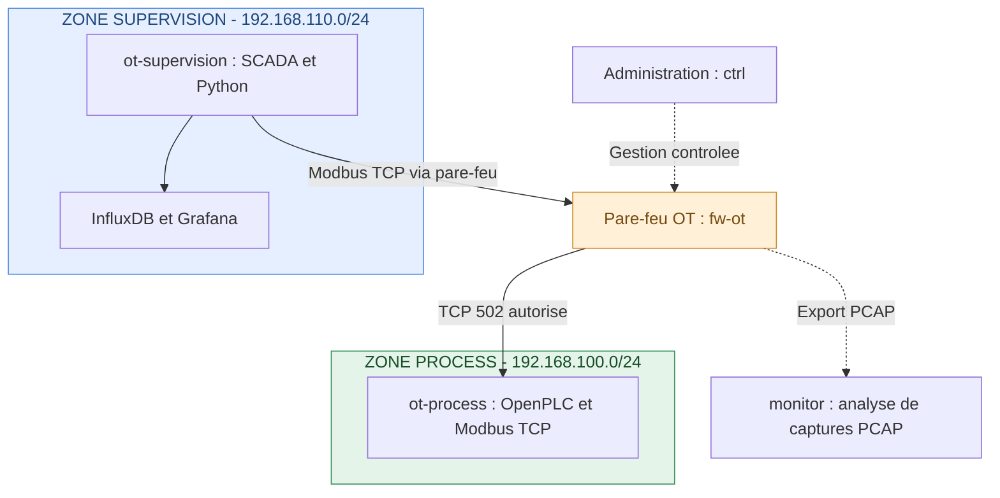

# Laboratoire IaC OT

Laboratoire pédagogique indépendant consacré à l'Infrastructure as Code (IaC), aux réseaux industriels et à la cybersécurité OT.

## Objectifs

- Construire une infrastructure virtuelle reproductible.
- Simuler un procédé industriel avec OpenPLC et Modbus/TCP.
- Mettre en place une architecture réseau segmentée et sécurisée.
- Développer un collecteur de données industrielles en Python.
- Superviser les données avec InfluxDB et Grafana.
- Analyser le trafic réseau avec des outils de surveillance.
- Documenter les configurations, les tests et les résultats.

## Technologies prévues

- VMware Workstation
- Vagrant
- Ansible
- Terraform
- Docker et Docker Compose
- Python
- OpenPLC et Modbus/TCP
- InfluxDB et Grafana
- Zeek ou Suricata
- Git et GitHub

## Architecture
Le laboratoire repose sur une architecture industrielle segmentée,
inspirée du modèle Purdue et des principes de zones et conduits IEC 62443.

### Principes de sécurité

- Séparation des réseaux GESTION, PROCESS et SUPERVISION.
- Contrôle des communications interzones par un pare-feu dédié.
- Politique de filtrage restrictive avec autorisations explicites.
- Supervision du procédé industriel via Modbus/TCP.
- Collecte et historisation des mesures avec Python et InfluxDB.
- Surveillance et analyse du trafic industriel.

> Cette architecture représente la cible du projet.
> Les composants seront déployés et validés progressivement.

## État du projet

Phase 0 — Préparation de l'environnement et du dépôt Git.

Le laboratoire est en cours de construction. Les fonctionnalités décrites constituent les objectifs du projet et ne sont pas encore déployées.

## Auteur

YGregCls

## Avertissement

Ce laboratoire est destiné exclusivement à l'apprentissage, à la simulation et aux tests dans un environnement virtuel isolé.
  