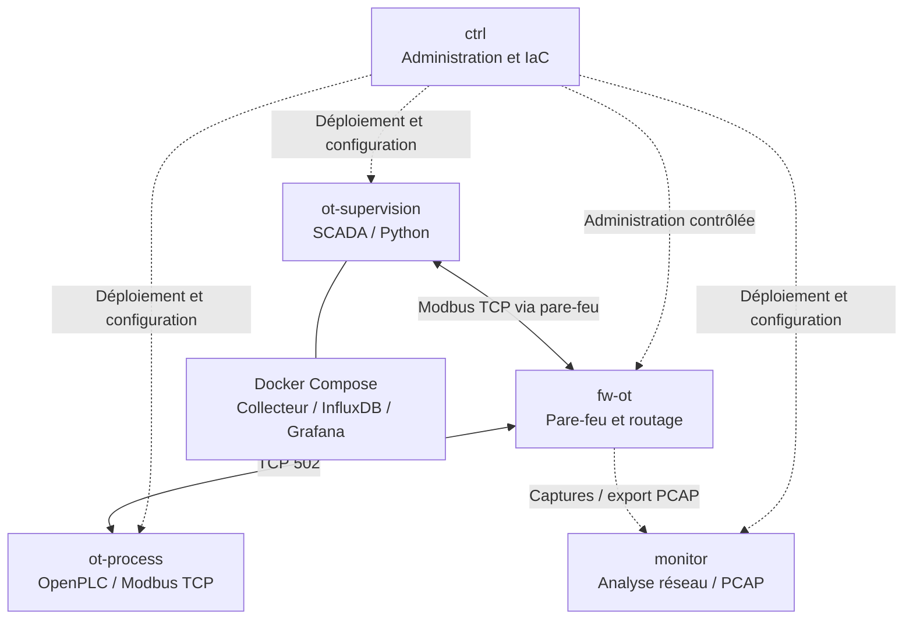

# Labo IaC OT — Infrastructure industrielle automatisée et sécurisée

> Laboratoire pédagogique d'Infrastructure as Code (IaC), de réseaux industriels et de cybersécurité OT, construit avec VMware Workstation, Vagrant, Ansible, Terraform, Docker, Docker Compose et Python.

**Statut :** 🚧 En développement — infrastructure et services industriels en cours de construction.

## 1. Présentation du projet

Ce projet vise à concevoir, déployer, administrer et sécuriser une infrastructure industrielle virtuelle reproductible.

Le laboratoire simule une installation industrielle comprenant :
- un procédé physique simulé et son contrôleur ;
- des communications industrielles Modbus TCP ;
- une supervision SCADA ;
- une historisation des mesures ;
- une visualisation avec Grafana ;
- un pare-feu assurant la segmentation réseau ;
- une plateforme de surveillance des communications.

L'infrastructure est réalisée avec une approche Infrastructure as Code afin de faciliter sa reconstruction, son évolution, sa validation et sa documentation.

Il s'agit d'un environnement pédagogique isolé : aucun équipement industriel réel n'est contrôlé.

## 2. Objectifs pédagogiques

Les objectifs sont de :

1. Comprendre et pratiquer la virtualisation VMware.
2. Déployer plusieurs machines avec Vagrant.
3. Apprendre Ansible, ses inventaires, ses modules et ses playbooks.
4. Comprendre l'idempotence et l'automatisation déclarative.
5. Découvrir Terraform et la gestion de ressources par le code.
6. Apprendre Docker, les images, les conteneurs, les réseaux et les volumes.
7. Déployer des applications avec Docker Compose.
8. Développer une simulation industrielle utilisant Modbus TCP.
9. Mettre en place un système de supervision et d'historisation.
10. Sécuriser les communications entre zones industrielles.
11. Observer et analyser les flux réseau.
12. Documenter les réalisations et démontrer leur fonctionnement.

## 3. Environnement technique

### Poste hôte

| Composant | Environnement |
|---|---|
| Ordinateur | Lenovo ThinkPad |
| Système | Windows 11 |
| Processeur | AMD Ryzen 7 |
| Mémoire | Environ 35 Go |
| Hyperviseur | VMware Workstation 25 |
| Gestion des VM | Vagrant |
| Éditeur | Visual Studio Code |
| Versionnement | Git et GitHub |

### Technologies du laboratoire

| Technologie | Utilisation prévue |
|---|---|
| Vagrant | Déclaration et gestion des machines virtuelles |
| VMware | Exécution des machines virtuelles |
| Ansible | Configuration et automatisation |
| Terraform | Déclaration et gestion de ressources Docker |
| Docker Engine | Exécution d'applications conteneurisées |
| Docker Compose v2 | Déploiement des services de supervision |
| Python | Simulation, collecte et traitement des données |
| OpenPLC | Simulation d'un contrôleur industriel |
| Modbus TCP | Communications industrielles |
| InfluxDB | Historisation des mesures |
| Grafana | Tableaux de bord |
| Linux | Routage et filtrage interzones |
| Zeek / Suricata | Surveillance et analyse réseau |

Les technologies prévues ne sont pas nécessairement déjà installées.

## 4. Architecture cible

Le laboratoire comprend cinq machines virtuelles.



**Attention :** ce schéma représente l'architecture fonctionnelle cible. Les interfaces réseau, les routes, les règles de filtrage et les mécanismes de capture restent à mettre en œuvre et à valider.

### Rôle des machines

| VM | Fonction |
|---|---|
| `ctrl` | Nœud d'administration et de contrôle Ansible |
| `ot-process` | Simulation industrielle, OpenPLC et Modbus TCP |
| `ot-supervision` | SCADA, collecte Python, InfluxDB et Grafana |
| `fw-ot` | Routage et filtrage entre les zones |
| `monitor` | Surveillance du trafic et analyse PCAP |

## 5. Plan d'adressage réseau

### Réseaux prévus

| Réseau | Sous-réseau | Statut |
|---|---|---|
| Gestion | `192.168.56.0/24` | Prévu |
| Process | `192.168.100.0/24` | Prévu |
| Supervision | `192.168.110.0/24` | Prévu |
| VMware NAT | `192.168.75.0/24` | Existant |

Correspondance VMware envisagée :

- VMnet2 : Gestion
- VMnet3 : Process
- VMnet4 : Supervision
- VMnet8 : NAT

VMnet2, VMnet3 et VMnet4 restent à créer et à valider.

### Adresses actuellement confirmées

La machine `ctrl` dispose d'une interface NAT dont l'adresse observée est :

`192.168.75.134/24`

Cette adresse dépend de l'attribution DHCP et peut changer.

Les futures adresses des interfaces industrielles et du pare-feu seront documentées après validation.

### Principes de segmentation

- Le réseau Process et le réseau Supervision sont séparés.
- Les communications interzones doivent traverser `fw-ot`.
- Le trafic Modbus TCP doit être explicitement autorisé.
- Les flux non autorisés doivent être bloqués.
- L'administration doit être limitée aux chemins autorisés.
- Les réseaux Docker ne doivent pas créer de chemin contournant le pare-feu.
- Les règles doivent être vérifiées par des tests de connectivité positifs et négatifs.

L'architecture s'inspire du modèle Purdue et des principes de segmentation en zones et conduits utilisés en cybersécurité industrielle.

## 6. Répartition des outils IaC

### Vagrant — Infrastructure virtuelle

Vagrant permet de déclarer les machines virtuelles et leurs caractéristiques à partir d'un `Vagrantfile`.

Il prend notamment en charge :
- les images système ;
- les ressources CPU et RAM ;
- les noms des machines ;
- les interfaces réseau ;
- le démarrage et l'arrêt des VM.

### Ansible — Automatisation des configurations

Ansible est exécuté depuis le nœud de contrôle `ctrl`.

Il permet de :
- configurer des machines Linux ;
- installer des dépendances ;
- gérer des fichiers et services ;
- appliquer des configurations de sécurité ;
- installer et configurer Docker ;
- déployer des applications ;
- vérifier les états attendus.

Un inventaire indique les machines ciblées. Les playbooks YAML décrivent les tâches à exécuter.

### Terraform — Gestion déclarative des ressources

Terraform sera utilisé pour apprendre la gestion de ressources Docker sur `ot-process`, selon un périmètre défini et distinct de Vagrant et de Docker Compose.

Ce volet sera réalisé après validation des machines et de leur connectivité.

### Docker — Conteneurisation

Docker permet d'exécuter des applications dans des conteneurs isolés.

Le parcours pédagogique couvrira :
- images et conteneurs ;
- Dockerfile ;
- ports et réseaux ;
- volumes persistants ;
- commandes de gestion ;
- journaux et diagnostic ;
- sécurité des conteneurs.

### Docker Compose — Services applicatifs

Docker Compose v2 sera principalement utilisé sur `ot-supervision`.

Les services visés sont :
- collecteur Python ;
- InfluxDB ;
- Grafana.

Les services, volumes, réseaux internes et paramètres seront décrits dans un fichier `compose.yaml`.

Ansible pourra ensuite automatiser leur déploiement.

## 7. Simulation industrielle

Le laboratoire simulera un procédé de pompage avec :

- niveau de cuve ;
- état de pompe ;
- état de vanne ;
- consigne ;
- alarmes.

Le contrôleur simulé exposera des variables par Modbus TCP.

Le port standard ciblé est TCP 502. Les adresses des registres, leur type, leur encodage et la fréquence d'acquisition seront documentés lors du développement.

Le collecteur Python devra :
1. lire les données Modbus ;
2. vérifier et convertir les valeurs ;
3. gérer les erreurs et les déconnexions ;
4. écrire les mesures dans InfluxDB ;
5. permettre leur visualisation dans Grafana.

## 8. Cybersécurité et surveillance

Le laboratoire permettra de tester :

- la segmentation réseau ;
- le filtrage des communications ;
- le contrôle des accès d'administration ;
- la journalisation ;
- les captures PCAP ;
- l'analyse des flux Modbus ;
- la détection d'événements réseau.

Les expérimentations seront limitées aux machines virtuelles appartenant au laboratoire.

La disponibilité du procédé simulé sera prise en compte pendant les opérations de configuration et de test.

## 9. État d'avancement réel

### Réalisations validées

- [x] Initialisation du dépôt Git.
- [x] Configuration de GitHub.
- [x] Installation et configuration de Vagrant.
- [x] Intégration VMware Workstation.
- [x] Déploiement d'une VM Ubuntu `ctrl`.
- [x] Validation de la connexion SSH.
- [x] Vérification des ressources CPU et RAM.
- [x] Tests du cycle de vie Vagrant.
- [x] Test de persistance et de reconstruction.
- [x] Installation de Python, pipx et Ansible.
- [x] Création d'un inventaire Ansible.
- [x] Visualisation de l'inventaire avec `--graph`.
- [x] Premier test Ansible réussi.
- [x] Création et exécution d'un premier playbook.
- [x] Démonstration de l'idempotence.
- [x] Snapshot de référence de `ctrl`.
- [x] Validation syntaxique du Vagrantfile multi-VM.

### Travaux en cours ou à venir

- [ ] Vérifier la reconnaissance des VM dans le nouveau Vagrantfile.
- [ ] Créer les réseaux VMware dédiés.
- [ ] Déployer et configurer `ot-process`.
- [ ] Déployer et configurer `ot-supervision`.
- [ ] Déployer `fw-ot`.
- [ ] Configurer le routage et les règles de filtrage.
- [ ] Déployer `monitor`.
- [ ] Installer Docker Engine et Docker Compose.
- [ ] Déployer les services conteneurisés.
- [ ] Mettre en place OpenPLC et Modbus TCP.
- [ ] Développer le collecteur Python.
- [ ] Afficher les mesures dans Grafana.
- [ ] Tester les communications interzones.
- [ ] Produire et analyser les captures PCAP.
- [ ] Mettre en œuvre le périmètre Terraform.
- [ ] Valider la reconstruction et la documentation complète.

**Important :** un outil déclaré dans l'architecture n'est pas considéré comme opérationnel tant qu'un test n'a pas démontré son fonctionnement.

## 10. Premiers résultats Ansible

### Inventaire local

```ini
[controllers]
ctrl ansible_connection=local ansible_python_interpreter=/usr/bin/python3.12
```

### Visualisation de l'inventaire

Commande :

```bash
ansible-inventory -i inventory.ini --graph
```

Résultat observé :

```text
@all:
  |--@ungrouped:
  |--@controllers:
  |  |--ctrl
```

Cette représentation est une alternative plus lisible à la sortie JSON de l'inventaire.

### Test de connectivité

Commande :

```bash
ansible controllers -i inventory.ini -m ping
```

Résultat observé :

```text
ctrl | SUCCESS => {
    "changed": false,
    "ping": "pong"
}
```

Interprétation :
- `SUCCESS` : module exécuté correctement ;
- `changed: false` : aucune modification ;
- `pong` : réponse du module Ansible.

Le module `ping` d'Ansible n'est pas un ping ICMP classique.

### Test d'idempotence

Un playbook utilise `ansible.builtin.file` pour garantir l'existence d'un répertoire.

Première exécution :

```text
ok=1 changed=1 unreachable=0 failed=0
```

Deuxième exécution :

```text
ok=1 changed=0 unreachable=0 failed=0
```

La première exécution a créé le répertoire.

La deuxième a constaté que l'état souhaité était déjà atteint.

Ce test démontre l'idempotence de cette tâche : une réexécution n'a pas produit de modification supplémentaire.

## 11. Organisation du dépôt

Arborescence cible :

```text
labo-iac-ot/
├── README.md
├── .gitignore
├── Vagrantfile
├── ansible/
│   ├── inventory.ini
│   └── playbooks/
├── terraform/
│   └── process/
├── compose/
│   └── supervision/
├── python/
│   └── ot_collector/
├── firewall/
├── tests/
└── docs/
    ├── architecture/
    ├── procedures/
    └── validation/
```

Cette structure représente une cible d'organisation. Tous les répertoires ne sont pas encore créés ni versionnés.

### Documentation disponible

- [Phase 01 — Vagrant et VMware](docs/phase-01-vagrant-vmware.md)

Les prochains documents détailleront Ansible, les réseaux, Docker, Terraform, Modbus, la supervision et les validations de cybersécurité.

## 12. Principes de validation

Chaque phase doit produire :

1. Une configuration documentée.
2. Des commandes reproductibles.
3. Une vérification fonctionnelle.
4. Des résultats ou captures utiles.
5. Une explication des erreurs rencontrées.
6. Une mise à jour du suivi d'avancement.

Les validations techniques doivent distinguer les résultats observés des résultats attendus.

## 13. Sécurité du dépôt

Les informations sensibles ne doivent pas être publiées dans Git.

Cela comprend notamment :
- clés privées SSH ;
- mots de passe et jetons ;
- véritables fichiers `.env` contenant des secrets ;
- états Terraform sensibles ;
- disques de VM ;
- dossiers `.vagrant` ;
- volumes et bases de données Docker ;
- captures réseau comportant des données confidentielles.

Les exemples de configuration doivent utiliser des valeurs fictives ou des variables documentées.


## 14. Finalité

Le but est de construire progressivement un environnement industriel virtuel complet, fonctionnel, automatisé, observable et reproductible.

Le laboratoire constitue également un support d'apprentissage et de démonstration de compétences en administration Linux, réseaux industriels, Infrastructure as Code et cybersécurité OT.

Les fonctionnalités seront considérées comme terminées uniquement après validation technique.
