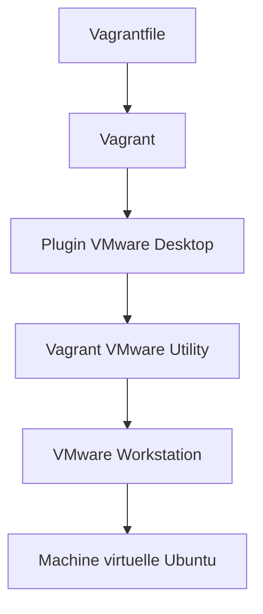
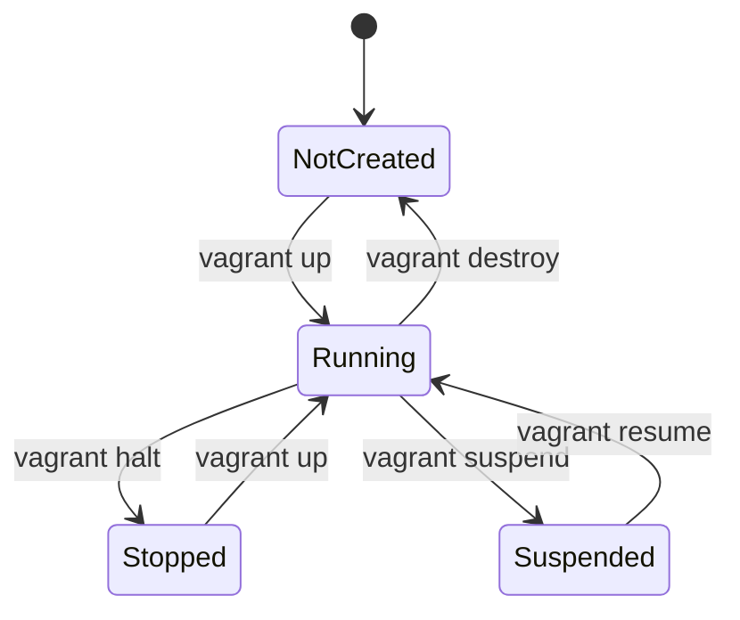
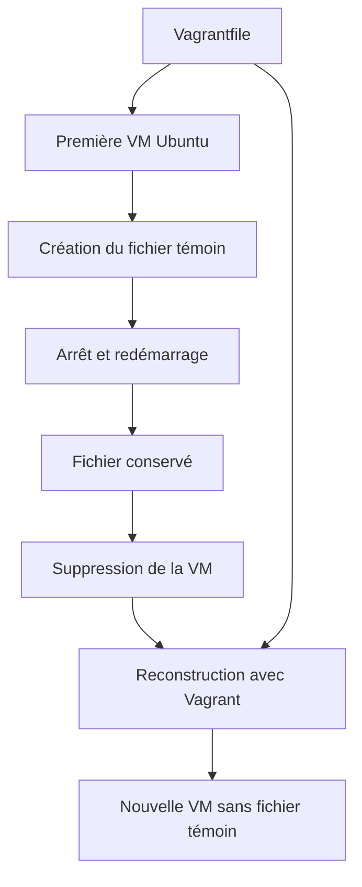

# Phase 01 — Vagrant et VMware Workstation

## 1. Présentation

Cette phase consiste à préparer l'environnement Infrastructure as Code
et à déployer une première machine virtuelle Linux à l'aide de Vagrant
et VMware Workstation.

Le laboratoire est indépendant des autres environnements virtuels
présents sur le poste Windows.

### Objectifs pédagogiques

- Comprendre le principe de l'Infrastructure as Code.
- Découvrir le fonctionnement de Vagrant.
- Comprendre la différence entre Vagrant et un hyperviseur.
- Installer et configurer le fournisseur VMware.
- Écrire un premier Vagrantfile.
- Créer automatiquement une machine virtuelle Linux.
- Administrer une VM avec SSH.
- Vérifier les ressources matérielles et réseau.
- Comprendre les principes de reproductibilité.

---

## 2. Infrastructure utilisée

### Ordinateur hôte

| Composant | Configuration |
|---|---|
| Système | Windows 11 |
| Ordinateur | Lenovo ThinkPad |
| Processeur | AMD Ryzen 7 7735HS |
| Cœurs physiques | 8 |
| Processeurs logiques | 16 |
| RAM | 30,78 Gio |
| Hyperviseur | VMware Workstation 25.0.0 |
| Stockage du projet | D: |

### Outils installés

| Outil | Version |
|---|---|
| Vagrant | 2.4.9 |
| Vagrant VMware Utility | 1.0.24 |
| vagrant-vmware-desktop | 3.0.5 |
| Git | 2.56.0.windows.3 |
| Visual Studio Code | Installé |

---

## 3. Comprendre l'Infrastructure as Code

L'Infrastructure as Code, ou IaC, consiste à décrire
et à gérer une infrastructure informatique au moyen
de fichiers de configuration et de code.

Dans une infrastructure traditionnelle, les machines
virtuelles sont souvent créées manuellement.

Avec l'IaC, les caractéristiques de l'infrastructure
sont décrites dans des fichiers qui peuvent être
versionnés, relus et réutilisés.

### Avantages

- Reproductibilité des environnements.
- Réduction des erreurs de configuration manuelle.
- Traçabilité des modifications.
- Automatisation des déploiements.
- Documentation de l'infrastructure.
- Facilitation des tests et de la reconstruction.

### Application à notre laboratoire OT

Nous utiliserons progressivement :

- Vagrant pour créer les machines virtuelles.
- Ansible pour configurer les systèmes Linux.
- Terraform pour gérer les ressources Docker du procédé.
- Docker Compose pour les services de supervision.
- Python pour collecter les données industrielles.
- Git pour versionner les configurations.

---

## 4. Architecture Vagrant et VMware



### Rôle des composants

**Vagrant**

Outil permettant de définir, créer et gérer
des environnements virtuels reproductibles.

**VMware Workstation**

Hyperviseur chargé d'exécuter les machines virtuelles.

**Plugin VMware Desktop**

Extension permettant à Vagrant de gérer VMware Workstation.

**VMware Utility**

Service Windows assurant certaines communications
entre Vagrant et VMware.

**Vagrantfile**

Fichier écrit en Ruby contenant la description
de l'environnement à créer.

---

## 5. Installation de Vagrant

### Téléchargement

Source officielle :

https://developer.hashicorp.com/vagrant/install

Version installée : Vagrant 2.4.9 pour Windows AMD64.

Fichier utilisé :

`vagrant_2.4.9_windows_amd64.msi`

### Vérification

Terminal : Windows PowerShell.

```powershell
vagrant --version
```

Résultat obtenu :

```text
Vagrant 2.4.9
```

Validation : installation réussie.

---

## 6. Installation de VMware Utility

Source officielle :

https://developer.hashicorp.com/vagrant/install/vmware

Version installée : 1.0.24.

### Vérification du service Windows

```powershell
Get-Service -Name "vagrant-vmware-utility"
```

Résultat observé :

```text
Status   Name             DisplayName
Running  VagrantVMware    vagrant-vmware-utility
```

Le service est actif.

---

## 7. Installation du plugin VMware Desktop

Commande utilisée :

```powershell
vagrant plugin install vagrant-vmware-desktop
```

Version installée : 3.0.5.

Commande de vérification :

```powershell
vagrant plugin list
```

Le plugin VMware Desktop a été confirmé comme installé.

---

## 8. Création du Vagrantfile

Le fichier est enregistré dans :

`D:\Labo-IaC-OT\projet\Vagrantfile`

### Configuration initiale

```ruby
Vagrant.configure("2") do |config|

  # Image Linux de base
  config.vm.box = "bento/ubuntu-24.04"

  # Nom de la machine
  config.vm.hostname = "ctrl"

  # Configuration VMware
  config.vm.provider "vmware_desktop" do |vmware|
    vmware.vmx["memsize"] = "2048"
    vmware.vmx["numvcpus"] = "2"

    # Emplacement des machines virtuelles
    vmware.clone_directory = "D:/Labo-IaC-OT/vms"
  end

end
```

### Explication

`Vagrant.configure("2")`

Déclare le format de configuration utilisé par Vagrant.

`config.vm.box`

Définit l'image Linux servant de base à la VM.

`config.vm.hostname`

Définit le nom d'hôte du système Linux.

`config.vm.provider`

Sélectionne le fournisseur de virtualisation.

`memsize`

Définit la quantité de mémoire RAM attribuée à la VM.

`numvcpus`

Définit le nombre de processeurs virtuels.

`clone_directory`

Indique le répertoire où stocker les clones VMware.

### Remarque sur le nom de la machine

Vagrant identifie initialement cette machine sous le nom `default`.

Le système Ubuntu possède quant à lui le nom d'hôte `ctrl`.

Ces deux notions sont différentes.

---

## 9. Validation du Vagrantfile

Commande utilisée depuis le dossier du projet :

```powershell
vagrant validate
```

Résultat :

```text
Vagrantfile validated successfully.
```

La configuration a été acceptée par Vagrant.

Cette vérification ne garantit pas à elle seule
que le déploiement fonctionnera.

---

## 10. Déploiement de la machine virtuelle

Commande utilisée :

```powershell
vagrant up --provider=vmware_desktop
```

### Fonctionnement

Vagrant effectue plusieurs opérations :

1. Lecture du Vagrantfile.
2. Recherche de l'image Ubuntu.
3. Téléchargement de l'image si nécessaire.
4. Création du clone VMware.
5. Configuration des ressources.
6. Démarrage de la VM.
7. Préparation de l'accès SSH.

### Image utilisée

- Projet : Bento.
- Distribution : Ubuntu 24.04.
- Version de box : 202510.26.0.
- Fournisseur : vmware_desktop.
- Architecture : amd64.

### Résultat observé

```text
Machine booted and ready!
```

Le déploiement a réussi.

---

## 11. Vérification de la VM

### Vérifier son état

```powershell
vagrant status
```

Résultat :

```text
default    running (vmware_desktop)
```

La machine est démarrée.

### Connexion SSH

```powershell
vagrant ssh
```

Invite Linux obtenue :

```text
vagrant@ctrl:~$
```

L'administration SSH est fonctionnelle.

### Vérifier le système

Commande Linux :

```bash
hostnamectl
```

Informations confirmées :

- Nom d'hôte : ctrl.
- Distribution : Ubuntu 24.04.3 LTS.
- Noyau : Linux 6.8.0-86-generic.
- Architecture : x86-64.
- Virtualisation : VMware.

---

## 12. Vérification des ressources

### Mémoire

Commande :

```bash
free -h
```

Résultat observé :

| Indicateur | Valeur |
|---|---|
| RAM totale | 1,9 Gio |
| RAM utilisée | 334 Mio |
| RAM disponible | 1,6 Gio |
| Swap total | 2,9 Gio |
| Swap utilisé | 0 |

La mémoire attribuée est conforme à la configuration prévue.

### Processeur

Commande :

```bash
nproc
```

Résultat :

```text
2
```

Les deux vCPU sont disponibles.

---

## 13. Réseau initial

La VM utilise temporairement le réseau NAT VMware.

| Élément | Valeur |
|---|---|
| Réseau | VMnet8 |
| Sous-réseau | 192.168.75.0/24 |
| Adresse Ubuntu observée | 192.168.75.133 |
| Interface Linux | eth0 |
| SSH Vagrant | 127.0.0.1:2222 |

Ce réseau sert à la préparation du laboratoire.

L'architecture finale reposera sur des réseaux
GESTION, PROCESS et SUPERVISION séparés.

Aucune connexion avec les autres laboratoires OT
n'est prévue.

---

## 14. Stockage VMware

Les clones VMware sont stockés dans :

`D:\Labo-IaC-OT\vms`

La présence du répertoire de la VM
et des fichiers VMware a été vérifiée.

Les fichiers des VM ne doivent pas être
ajoutés au dépôt GitHub.

Attention : les images de base Vagrant
peuvent également être conservées dans
le répertoire global de Vagrant sous Windows.

---

## 15. Commandes Vagrant à connaître

| Commande | Fonction |
|---|---|
| `vagrant validate` | Valider le Vagrantfile |
| `vagrant up` | Créer ou démarrer la VM |
| `vagrant status` | Consulter l'état des VM |
| `vagrant ssh` | Se connecter en SSH |
| `vagrant halt` | Arrêter proprement la VM |
| `vagrant suspend` | Suspendre la VM |
| `vagrant reload` | Redémarrer la VM et recharger la configuration |
| `vagrant provision` | Relancer les provisionneurs configurés |
| `vagrant destroy` | Supprimer la VM gérée par Vagrant |

Attention : certaines commandes de ce tableau
n'ont pas encore été testées dans le laboratoire.

`vagrant destroy` est une opération destructive
qui peut entraîner la perte des données locales
contenues dans la machine virtuelle.

---

## 16. Bonnes pratiques

- Conserver les configurations dans Git.
- Exclure les images et disques virtuels du dépôt.
- Vérifier les modifications avant chaque commit.
- Protéger les clés privées SSH.
- Contrôler les réseaux utilisés par les VM.
- Documenter les versions réellement installées.
- Ne pas confondre validation syntaxique et test fonctionnel.
- Prévoir des points de sauvegarde adaptés.
- Tester progressivement la reproductibilité.

---

## 17. Résultats de la phase

### Validations réalisées

- Installation de Vagrant.
- Installation de VMware Utility.
- Vérification du service Windows.
- Installation du plugin VMware Desktop.
- Création du premier Vagrantfile.
- Validation syntaxique.
- Téléchargement de la box Ubuntu.
- Création et démarrage de la VM.
- Connexion SSH fonctionnelle.
- Vérification du système Linux.
- Vérification de la RAM et des vCPU.
- Vérification du stockage sur D:.

### Travaux restant à réaliser

- Tester l'arrêt et le redémarrage de la VM.
- Vérifier la reproductibilité du déploiement.
- Préparer le réseau GESTION dédié.
- Automatiser la configuration Linux avec Ansible.
- Étendre progressivement l'architecture.

---
## 18. Tests du cycle de vie Vagrant

### Objectif

Vérifier que la machine virtuelle peut être arrêtée,
redémarrée et administrée sans intervention manuelle
dans VMware Workstation.

Ces tests permettent de valider la gestion du cycle
de vie de notre première infrastructure automatisée.

### Test 1 — Arrêt propre de la VM

Commande exécutée depuis Windows PowerShell :

```powershell
vagrant halt
```

**Résultat :** la machine virtuelle Ubuntu a été arrêtée.

**Validation :** réussie.

La commande n'a pas supprimé la VM ni son disque virtuel.

### Test 2 — Redémarrage de la VM

Commande exécutée :

```powershell
vagrant up
```

**Résultat :** la machine virtuelle existante a redémarré.

**Validation :** réussie.

Vagrant a réutilisé l'environnement déjà créé.

### Test 3 — Vérification de l'état

Commande exécutée :

```powershell
vagrant status
```

Résultat observé :

```text
default    running (vmware_desktop)
```

**Validation :** réussie.

La VM est correctement reconnue par Vagrant après redémarrage.

### Test 4 — Vérification de l'accès SSH

Commande :

```powershell
vagrant ssh -c "hostname"
```

Résultat attendu et confirmé :

```text
ctrl
```

**Validation :** réussie.

L'accès SSH et le nom d'hôte Linux sont fonctionnels
après le redémarrage de la machine.

### Schéma du cycle de vie



Les états liés à `suspend`, `resume` et `destroy`
sont présentés à titre pédagogique.
Ces commandes n'ont pas encore été testées.

### Synthèse des validations

| Test | Résultat |
|---|---|
| Création initiale de la VM | Réussi |
| Démarrage Ubuntu | Réussi |
| Connexion SSH initiale | Réussi |
| Arrêt avec vagrant halt | Réussi |
| Redémarrage avec vagrant up | Réussi |
| Vérification vagrant status | Réussi |
| Accès SSH après redémarrage | Réussi |

### Conclusion des tests

La gestion de base du cycle de vie de notre VM
avec Vagrant et VMware Workstation est fonctionnelle.

Ces tests confirment que nous pouvons arrêter
et redémarrer la machine sans devoir la recréer.

Ils ne constituent pas encore une preuve de
reconstruction complète depuis un environnement vierge.


## 19. Test de persistance et reconstruction complète

### 19.1 Objectif pédagogique

Démontrer la différence entre :

- La persistance des données d'une VM existante.
- La reconstruction d'une nouvelle VM à partir du code.

Ce test permet de comprendre les limites de Vagrant
et la nécessité d'automatiser les configurations logicielles.

### 19.2 Architecture de l'expérience



### 19.3 Création du fichier témoin

Commande exécutée depuis Windows PowerShell :

```powershell
vagrant ssh -c "touch ~/test-persistance.txt"
```

La commande `touch` crée un fichier vide
dans le répertoire personnel de l'utilisateur Linux.

Vérification :

```powershell
vagrant ssh -c "ls -l ~/test-persistance.txt"
```

Résultat : fichier présent.

### 19.4 Vérification de la persistance

Arrêt de la machine :

```powershell
vagrant halt
```

Redémarrage :

```powershell
vagrant up
```

Nouvelle vérification du fichier :

```powershell
vagrant ssh -c "ls -l ~/test-persistance.txt"
```

Résultat : fichier toujours présent.

Conclusion : les données enregistrées sur le disque
virtuel survivent à un arrêt et à un redémarrage.

### 19.5 Suppression de la machine virtuelle

Avant la suppression, la machine cible a été vérifiée :

```powershell
vagrant status
```

Résultat :

```text
default    running (vmware_desktop)
```

Après confirmation explicite de la suppression,
la commande suivante a été exécutée :

```powershell
vagrant destroy default
```

Résultat :

```text
Stopping the VMware VM...
Deleting the VM...
```

Vérification :

```powershell
vagrant status
```

Résultat :

```text
default    not created (vmware_desktop)
```

La machine virtuelle de test a été supprimée.

Attention : cette opération entraîne la perte
des données enregistrées sur son disque virtuel,
sauf sauvegarde externe disponible.

### 19.6 Reconstruction complète

Commande :

```powershell
vagrant up --provider=vmware_desktop
```

Vagrant a recréé une machine virtuelle Ubuntu
à partir du Vagrantfile existant.

Le déploiement s'est terminé correctement.

### 19.7 Vérification du fichier témoin

Commande :

```powershell
vagrant ssh -c "if [ -e /home/vagrant/test-persistance.txt ]; then echo PRESENT; else echo ABSENT; fi"
```

Résultat :

```text
ABSENT
```

Le fichier créé manuellement dans l'ancienne VM
n'a pas été recréé.

### 19.8 Vérification des ressources

Commande :

```powershell
vagrant ssh -c "hostname; nproc; free -h"
```

Résultats observés :

| Paramètre | Résultat |
|---|---|
| Nom d'hôte | ctrl |
| Processeurs disponibles | 2 |
| RAM totale | 1,9 Gio |
| RAM disponible | 1,6 Gio |
| Swap total | 2,9 Gio |
| Swap utilisé | 0 |

Les caractéristiques observées correspondent
à la configuration attendue.

### 19.9 Bilan de l'expérience

| Test | Résultat |
|---|---|
| Création d'un fichier témoin | Réussi |
| Conservation après redémarrage | Réussi |
| Suppression contrôlée de la VM | Réussi |
| État not created | Confirmé |
| Reconstruction depuis le Vagrantfile | Réussi |
| Accès SSH après reconstruction | Réussi |
| Vérification du hostname | Réussi |
| Vérification des vCPU | Réussi |
| Vérification de la RAM | Réussi |
| Absence du fichier témoin | Confirmée |

### 19.10 Enseignements

Vagrant permet de décrire et de reconstruire
une infrastructure virtuelle.

Cependant, le Vagrantfile actuel ne décrit pas
l'ensemble de la configuration logicielle du système.

Les installations et modifications réalisées manuellement
dans Ubuntu ne sont donc pas automatiquement reproduites.

Dans la suite du projet, Ansible permettra de définir
et d'appliquer la configuration logicielle des machines.

L'objectif sera de pouvoir reconstruire non seulement
les VM, mais également les services nécessaires au laboratoire.