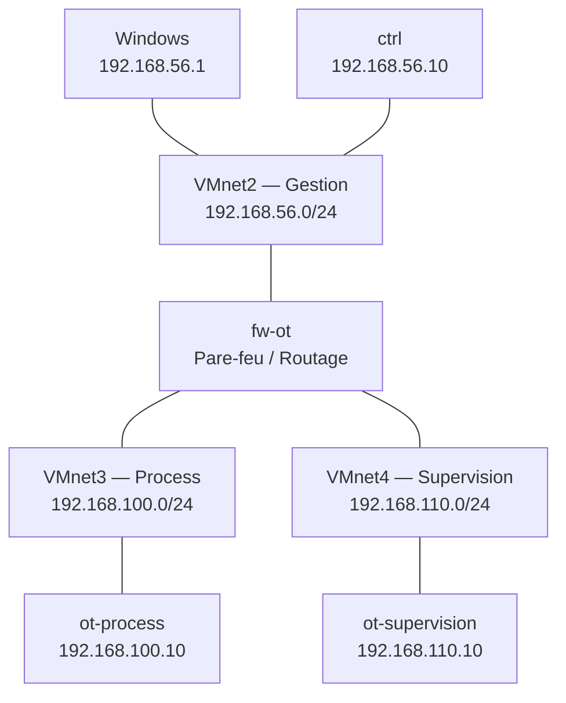

# Phase 02 — Architecture réseau et segmentation VMware

**Projet :** Labo IaC OT  
**Environnement :** Windows 11 / VMware Workstation / Vagrant  
**Statut :** Réseaux virtuels créés — connectivité de gestion de `ctrl` validée

---

## 1. Objectif de la phase

Cette phase consiste à préparer l'architecture réseau d'un laboratoire industriel virtuel destiné à l'apprentissage de l'Infrastructure as Code et de la cybersécurité OT.

L'objectif est de séparer les communications en plusieurs zones :

- Gestion : administration de l'infrastructure.
- Process : simulation du procédé industriel.
- Supervision : collecte et visualisation des données.
- NAT : connectivité externe nécessaire aux téléchargements et à certains accès Vagrant.

La segmentation vise à maîtriser les chemins de communication, faciliter l'application de politiques de sécurité et limiter les possibilités de circulation non autorisée entre zones.

**Périmètre :** ce laboratoire est indépendant du projet OTLAB2. Ses réseaux et ses machines ne doivent pas être confondus avec ceux de cet autre environnement.

---

## 2. Concepts fondamentaux

### 2.1 Qu'est-ce qu'un réseau virtuel VMware ?

VMware Workstation permet de créer des réseaux virtuels auxquels les machines virtuelles peuvent être connectées.

Ces réseaux sont identifiés par des noms tels que `VMnet1`, `VMnet2` ou `VMnet8`.

Ils jouent un rôle comparable à celui de segments réseau ou de commutateurs virtuels.

Leur configuration détermine notamment :
- les possibilités de communication entre les VM ;
- la présence éventuelle d'une interface sur l'hôte Windows ;
- l'accès à un réseau externe ;
- la disponibilité d'un service DHCP VMware.

### 2.2 Les modes réseau VMware

| Mode | Fonctionnement | Utilisation |
|---|---|---|
| Bridged | Connecte la VM au réseau physique de l'hôte | Accès direct au LAN |
| NAT | Permet notamment aux VM d'accéder à des réseaux externes via la traduction d'adresses | Téléchargements et connectivité externe |
| Host-only | Crée un segment privé entre VM, avec accès éventuel de l'hôte | Réseaux de laboratoire |
| Segment isolé sans adaptateur hôte | Communication entre VM raccordées au même VMnet | Zones industrielles isolées de l'hôte |

#### Bridged

En mode Bridged, la VM se comporte comme une machine connectée au réseau physique.

Elle peut obtenir une adresse du réseau local et communiquer selon les règles de ce réseau.

Ce mode n'est pas retenu pour les zones industrielles de notre laboratoire afin d'éviter de les connecter directement au LAN physique.

#### NAT

Le NAT, ou *Network Address Translation*, permet de traduire les adresses lors de communications entre réseaux.

Dans notre environnement VMware, VMnet8 assure cette fonction.

Le réseau NAT utilisé est :

`192.168.75.0/24`

L'hôte Windows possède l'adresse :

`192.168.75.1/24`

La machine `ctrl` possède actuellement :

`192.168.75.134/24`

Cette adresse est attribuée par DHCP et n'est pas considérée comme définitive.

**Important :** le NAT n'est pas une garantie suffisante d'isolation ou de sécurité. Il ne remplace pas un pare-feu.

#### Host-only

Un réseau Host-only est un segment virtuel privé.

Lorsqu'un adaptateur hôte est activé, Windows dispose d'une interface directement connectée à ce segment.

Si l'adaptateur hôte est désactivé, les VM raccordées au VMnet peuvent communiquer entre elles, mais Windows ne dispose pas d'une interface VMware directement connectée à ce réseau.

Cela ne constitue pas, à lui seul, une politique complète de sécurité.

---

## 3. Plan d'adressage retenu

### 3.1 Réseaux du laboratoire

| VMnet | Zone | Sous-réseau | Type | DHCP |
|---|---|---|---|---|
| VMnet2 | Gestion | `192.168.56.0/24` | Host-only | Désactivé |
| VMnet3 | Process | `192.168.100.0/24` | Réseau privé sans adaptateur hôte | Désactivé |
| VMnet4 | Supervision | `192.168.110.0/24` | Réseau privé sans adaptateur hôte | Désactivé |
| VMnet8 | NAT | `192.168.75.0/24` | NAT | Activé |

Les VMnet2, VMnet3 et VMnet4 ont été créés dans VMware Workstation.

### 3.2 Plan d'adressage des machines

| Machine | Réseau | Adresse |
|---|---|---|
| Windows | Gestion | `192.168.56.1/24` |
| ctrl | Gestion | `192.168.56.10/24` |
| ctrl | NAT | `192.168.75.134/24` (DHCP observé) |
| fw-ot | Gestion | `192.168.56.254/24` (prévu) |
| monitor | Gestion | `192.168.56.20/24` (prévu) |
| fw-ot | Process | `192.168.100.1/24` (prévu) |
| ot-process | Process | `192.168.100.10/24` (prévu) |
| fw-ot | Supervision | `192.168.110.1/24` (prévu) |
| ot-supervision | Supervision | `192.168.110.10/24` (prévu) |

Les adresses indiquées comme « prévues » ne sont pas encore attribuées.

### 3.3 Pourquoi utiliser des adresses statiques ?

Nous avons désactivé DHCP sur les réseaux dédiés afin de maîtriser précisément l'adressage.

Les adresses statiques présentent plusieurs avantages :

- identification stable des machines ;
- règles de pare-feu plus prévisibles ;
- configuration simplifiée des inventaires Ansible ;
- documentation plus facile à maintenir ;
- diagnostic réseau facilité.

La convention retenue est :

- `.1` : passerelle des zones industrielles ;
- `.10` : machine principale ;
- `.20` : machine secondaire ou surveillance ;
- `.254` : interface de gestion du pare-feu.

Cette convention est propre au laboratoire : elle ne constitue pas une norme universelle.

---

## 4. Architecture réseau cible



Ce schéma représente l'architecture logique cible.

`ctrl` dispose également d'une interface NAT sur VMnet8, non représentée pour conserver la lisibilité.

La future machine `monitor` sera raccordée selon une architecture de surveillance à définir.

### Objectif de sécurité

Les flux entre Process et Supervision devront traverser `fw-ot`.

Par exemple :

`ot-supervision → fw-ot → ot-process`

La communication Modbus TCP utilisera le port TCP 502 dans la configuration cible.

Le pare-feu devra autoriser les flux explicitement nécessaires et refuser les autres.

### Limites actuelles

À ce stade :

- les VMnet sont créés ;
- `ctrl` est raccordée au réseau de gestion ;
- les autres VM ne sont pas encore déployées ;
- les règles de pare-feu ne sont pas configurées ;
- l'isolation interzones n'a pas encore été démontrée par des tests.

La segmentation complète ne doit donc pas être considérée comme validée.

---

## 5. Vérification des réseaux existants

Avant de créer les nouveaux VMnet, les interfaces Windows ont été examinées.

Commande PowerShell :

```powershell
Get-NetIPAddress -AddressFamily IPv4 |
    Select-Object InterfaceAlias,IPAddress,PrefixLength
```

Principaux résultats observés :

| Interface | Adresse |
|---|---|
| Ethernet | `10.105.6.102/24` |
| VMnet1 | `192.168.154.1/24` |
| VMnet8 | `192.168.75.1/24` |
| vEthernet (Default Switch) | `172.30.128.1/20` |

Aucune des interfaces affichées n'utilisait directement les réseaux :

- `192.168.56.0/24`
- `192.168.100.0/24`
- `192.168.110.0/24`

Une recherche complémentaire a été effectuée dans la table de routage.

```powershell
Get-NetRoute -AddressFamily IPv4 |
    Where-Object {
        $_.DestinationPrefix -match '^192\.168\.(56|100|110)\.'
    } |
    Select-Object DestinationPrefix,InterfaceAlias,NextHop
```

La commande n'a retourné aucune ligne.

Cela confirmait l'absence de route dont le préfixe commençait par l'un des trois sous-réseaux recherchés.

Cette recherche ne constituait pas un audit exhaustif de toutes les routes possibles, notamment des routes plus larges.

---

## 6. Configuration de VMnet2 — Gestion

### Paramètres

| Paramètre | Valeur |
|---|---|
| Nom | VMnet2 |
| Type | Host-only |
| Sous-réseau | `192.168.56.0` |
| Masque | `255.255.255.0` |
| Adaptateur Windows | Activé |
| DHCP VMware | Désactivé |

### Justification

VMnet2 est destiné à l'administration des machines.

L'adaptateur Windows est activé pour permettre à l'hôte d'accéder directement aux machines connectées au réseau de gestion.

L'attribution des adresses est statique.

### Vérification de l'adaptateur Windows

Commande :

```powershell
Get-NetIPAddress -InterfaceAlias "VMware Network Adapter VMnet2" -AddressFamily IPv4
```

Résultat observé :

```text
IPAddress      : 192.168.56.1
InterfaceIndex : 60
PrefixLength   : 24
PrefixOrigin   : Manual
AddressState   : Preferred
```

Interprétation :

- `IPAddress` : adresse de l'interface Windows ;
- `InterfaceIndex` : identifiant de l'interface ;
- `PrefixLength` : masque réseau en notation CIDR ;
- `PrefixOrigin` : origine de l'adresse ;
- `AddressState` : état de l'adresse IPv4.

**Validation :** l'interface Windows VMnet2 est configurée sur le réseau attendu.

---

## 7. Configuration de VMnet3 — Process

### Paramètres

| Paramètre | Valeur |
|---|---|
| Nom | VMnet3 |
| Type | Réseau privé VMware |
| Sous-réseau | `192.168.100.0` |
| Masque | `255.255.255.0` |
| Adaptateur Windows | Désactivé |
| DHCP VMware | Désactivé |

### Justification

Ce réseau accueillera la simulation industrielle.

La désactivation de l'adaptateur hôte évite une connexion directe de Windows à la zone Process via VMnet3.

L'objectif est de contrôler les communications interzones au moyen du futur pare-feu.

### État

La configuration VMnet3 a été vérifiée visuellement dans VMware Workstation.

Le raccordement de `ot-process` et les tests d'isolation restent à effectuer.

---

## 8. Configuration de VMnet4 — Supervision

### Paramètres

| Paramètre | Valeur |
|---|---|
| Nom | VMnet4 |
| Type | Réseau privé VMware |
| Sous-réseau | `192.168.110.0` |
| Masque | `255.255.255.0` |
| Adaptateur Windows | Désactivé |
| DHCP VMware | Désactivé |

### Justification

VMnet4 accueillera la supervision industrielle.

Les composants prévus comprennent :
- le SCADA ;
- le collecteur Python ;
- Docker Compose ;
- InfluxDB ;
- Grafana.

Les échanges nécessaires avec le procédé seront acheminés par le pare-feu interzones.

### État

VMnet4 a été créé et vérifié visuellement.

La VM de supervision et ses services ne sont pas encore déployés.

---

## 9. Ajout du réseau de gestion à ctrl

### Situation initiale

La VM `ctrl` possédait uniquement une interface NAT :

```text
lo    UNKNOWN    127.0.0.1/8
eth0  UP         192.168.75.134/24
```

Le réseau NAT était nécessaire aux téléchargements et à la connexion Vagrant.

### Objectif

Ajouter une interface statique :

`192.168.56.10/24`

tout en conservant l'interface NAT.

### Configuration Vagrant

Dans la définition de la machine `default`, dont le nom Linux est `ctrl`, la configuration suivante a été ajoutée :

```ruby
ctrl.vm.network "private_network",
  ip: "192.168.56.10",
  netmask: "255.255.255.0"
```

Explication :

- `ctrl.vm.network` : déclare un réseau pour la VM ;
- `private_network` : utilise un réseau privé Vagrant ;
- `ip` : définit l'adresse IPv4 statique ;
- `netmask` : définit le masque réseau.

### Vérification de la syntaxe

Commande :

```powershell
vagrant validate
```

Résultat :

```text
Vagrantfile validated successfully.
```

### Application de la configuration

Commande :

```powershell
vagrant reload default
```

Cette commande a redémarré uniquement la VM identifiée par Vagrant sous le nom `default`.

La VM `ot-process` était déclarée mais n'avait pas encore été créée.

### Avertissement VMware observé

Pendant le redémarrage, Vagrant a signalé :

```text
ethernet0.pcislotnumber = "160"
```

Cet avertissement concerne un paramètre matériel du fichier VMX que Vagrant réécrit actuellement.

Aucune erreur réseau n'a été constatée lors de cette opération.

Le paramètre n'a donc pas été modifié manuellement.

### Changement du port SSH redirigé

Vagrant a également indiqué :

```text
Fixed port collision for 22 => 2222. Now on port 2200.
```

Le port hôte initialement prévu pour la redirection SSH était indisponible.

Vagrant a choisi le port `2200`.

Le service SSH dans Ubuntu continue d'utiliser le port TCP 22.

---

## 10. Vérification des interfaces Ubuntu

Après le redémarrage, les interfaces ont été vérifiées depuis PowerShell.

Commande :

```powershell
vagrant ssh default -c "ip -br addr"
```

Résultat observé :

```text
lo    UNKNOWN  127.0.0.1/8
eth0  UP       192.168.75.134/24
eth1  UP       192.168.56.10/24
```

### Interprétation

| Interface | Adresse | Rôle |
|---|---|---|
| lo | `127.0.0.1/8` | Boucle locale |
| eth0 | `192.168.75.134/24` | NAT |
| eth1 | `192.168.56.10/24` | Gestion |

La machine possède donc deux interfaces IPv4 opérationnelles.

**Validation :** les adresses attendues sont présentes dans Ubuntu.

---

## 11. Test de connectivité ICMP

### Commande

Depuis Windows :

```powershell
ping 192.168.56.10
```

### Résultat observé

```text
Réponse de 192.168.56.10 : octets=32 temps<1ms TTL=64
Réponse de 192.168.56.10 : octets=32 temps<1ms TTL=64
Réponse de 192.168.56.10 : octets=32 temps<1ms TTL=64
Réponse de 192.168.56.10 : octets=32 temps<1ms TTL=64
```

Statistiques :

```text
Paquets envoyés : 4
Paquets reçus   : 4
Paquets perdus  : 0
Perte           : 0 %
```

### Interprétation

Les quatre requêtes ont reçu une réponse.

Le réseau VMnet2 permet donc la communication ICMP entre Windows et `ctrl`.

### Comprendre le TTL

Le TTL, ou *Time To Live*, est un champ de l'en-tête IPv4.

Il limite le nombre de routeurs qu'un paquet peut traverser.

Le TTL est normalement diminué lorsqu'un routeur transmet le paquet.

La valeur observée `TTL=64` est cohérente avec une réponse provenant directement d'un système Linux, sans saut routé intermédiaire. Elle ne constitue toutefois pas une preuve absolue du chemin suivi.

---

## 12. Test de connectivité TCP et SSH

Un ping ICMP réussi ne garantit pas qu'un service réseau est accessible.

Une deuxième vérification a donc été réalisée sur le port TCP 22.

### Commande

```powershell
Test-NetConnection 192.168.56.10 -Port 22
```

### Résultat observé

```text
ComputerName     : 192.168.56.10
RemoteAddress    : 192.168.56.10
RemotePort       : 22
InterfaceAlias   : VMware Network Adapter VMnet2
SourceAddress    : 192.168.56.1
TcpTestSucceeded : True
```

### Interprétation

- `ComputerName` : machine testée ;
- `RemoteAddress` : adresse IP cible ;
- `RemotePort` : port TCP ciblé ;
- `InterfaceAlias` : interface Windows utilisée ;
- `SourceAddress` : adresse IP source ;
- `TcpTestSucceeded` : réussite du test de connexion TCP.

**Validation :** le port TCP 22 de `ctrl` est accessible depuis Windows via VMnet2.

Ce test ne vérifie pas l'authentification SSH.

---

## 13. Synthèse des tests

| Test | Résultat |
|---|---|
| Analyse des interfaces Windows | Validé |
| Vérification préliminaire des sous-réseaux | Validé |
| Création VMnet2 | Validé |
| Création VMnet3 | Validé |
| Création VMnet4 | Validé |
| Adresse Windows VMnet2 | Validé |
| Syntaxe du Vagrantfile | Validé |
| Redémarrage de ctrl | Validé |
| Interface NAT conservée | Validé |
| Interface de gestion ajoutée | Validé |
| Ping Windows vers ctrl | Validé |
| Accessibilité TCP 22 | Validé |
| Authentification SSH directe sur VMnet2 | À tester |
| Routage interzones | À configurer |
| Filtrage par fw-ot | À configurer |
| Isolation Process / Supervision | À tester |

---

## 14. Principes de cybersécurité OT

### Séparation des fonctions

Les réseaux de gestion, de procédé et de supervision sont distingués afin de faciliter la définition de politiques de sécurité adaptées.

### Contrôle des communications

Le futur pare-feu `fw-ot` devra contrôler les communications entre Process et Supervision.

Les flux seront autorisés en fonction des besoins fonctionnels.

### Limitation des chemins de contournement

Une vigilance particulière sera apportée :

- aux interfaces multiples ;
- aux connexions NAT ;
- aux routes statiques ;
- aux adaptateurs hôte ;
- aux réseaux Docker ;
- aux communications directes entre VM.

L'objectif est d'éviter qu'une interface ou un réseau secondaire permette de contourner le filtrage prévu.

### Vérification par les tests

L'architecture sera validée avec des tests positifs et négatifs :

- vérifier qu'un flux autorisé fonctionne ;
- vérifier qu'un flux interdit est bloqué ;
- inspecter le chemin de routage ;
- observer les compteurs de pare-feu ;
- analyser des captures réseau.

La sécurité ne sera pas considérée comme validée uniquement parce que les réseaux sont séparés dans VMware.

---

## 15. Prochaines étapes

1. Vérifier l'authentification SSH via le réseau de gestion.
2. Déployer `ot-process` avec Vagrant.
3. Raccorder `ot-process` au réseau Process.
4. Déployer les autres machines du laboratoire.
5. Configurer les interfaces et le routage de `fw-ot`.
6. Tester l'isolation des zones.
7. Mettre en place OpenPLC et Modbus TCP.
8. Déployer la supervision avec Docker Compose.
9. Configurer la surveillance réseau.
10. Effectuer les tests de sécurité et de fonctionnement industriel.

---

## 16. Conclusion

Cette phase a permis de préparer trois réseaux dédiés au laboratoire IaC OT et de raccorder le nœud de contrôle à son réseau d'administration.

Les premiers tests ont validé :

- la présence des interfaces attendues ;
- la connectivité ICMP ;
- l'accessibilité TCP du service SSH.


**La création des réseaux constitue une étape de préparation de la segmentation, et non une validation définitive de la sécurité de l'infrastructure.**
