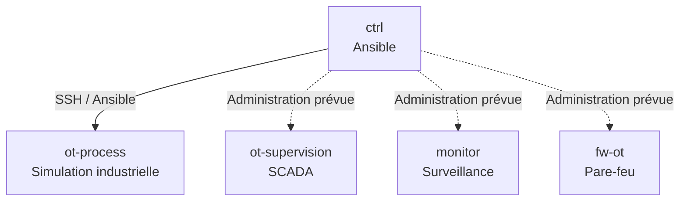
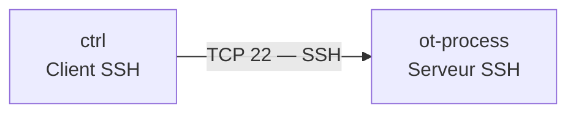

# Phase 03 — Ansible, SSH et automatisation des machines OT

**Projet :** Labo IaC OT  
**Environnement :** Windows 11, VMware Workstation, Vagrant, Ubuntu 24.04  
**Statut :** Première administration Ansible distante validée

---

## 1. Objectif de la phase

Cette phase consiste à installer et configurer Ansible, puis à établir une première administration distante sécurisée entre deux machines Linux.

Les objectifs sont les suivants :

1. Installer Ansible sur le nœud de contrôle `ctrl`.
2. Comprendre le rôle d'un nœud de contrôle.
3. Créer et utiliser un inventaire Ansible.
4. Découvrir les modules et les playbooks YAML.
5. Comprendre et démontrer l'idempotence.
6. Comprendre le fonctionnement de SSH.
7. Mettre en place une authentification par clé Ed25519.
8. Administrer `ot-process` depuis `ctrl`.
9. Réaliser un premier audit système automatisé.
10. Conserver le code source dans Git pour assurer la reproductibilité.

Cette phase utilise temporairement le réseau VMware NAT pour les communications SSH entre `ctrl` et `ot-process`.

Le chemin d'administration définitif sera revu lors de la mise en place du pare-feu `fw-ot`.

---

## 2. Comprendre les responsabilités des outils

Notre infrastructure utilise plusieurs outils complémentaires.

| Outil | Emplacement | Responsabilité |
|---|---|---|
| VMware Workstation | Windows | Exécuter les machines virtuelles |
| Vagrant | Windows | Créer et gérer les machines virtuelles |
| Ansible | Ubuntu `ctrl` | Automatiser les configurations |
| SSH | Machines Linux | Établir des connexions distantes sécurisées |
| Python | Machines Linux | Exécuter notamment les modules Ansible |
| Git | Windows | Versionner les configurations |
| GitHub | Dépôt distant | Conserver et partager la documentation et le code |

### 2.1 Vagrant et Ansible : quelle différence ?

Vagrant s'occupe principalement du cycle de vie des machines virtuelles :

- création ;
- démarrage ;
- arrêt ;
- redémarrage ;
- configuration initiale ;
- intégration avec VMware.

Ansible s'occupe principalement de leur configuration :

- installation de logiciels ;
- gestion des services ;
- déploiement de fichiers ;
- configuration système ;
- vérification des paramètres ;
- application de tâches d'administration.

**À retenir :**

> Vagrant administre les machines virtuelles depuis Windows, tandis qu'Ansible utilise principalement SSH depuis le nœud de contrôle Linux pour administrer les systèmes.

Ces deux outils sont complémentaires, mais remplissent des fonctions différentes.

### 2.2 Exemple concret

Pour créer `ot-process`, nous utilisons depuis Windows :

```powershell
vagrant up ot-process --provider=vmware_desktop
```

Pour vérifier son système depuis `ctrl`, nous utilisons Ansible :

```bash
ansible process -i inventory.ini -m ansible.builtin.ping
```

La première commande agit sur la machine virtuelle via Vagrant et VMware.

La seconde exécute une opération à l'intérieur du système Linux distant.

---

## 3. Le nœud de contrôle Ansible

### 3.1 Définition

Le nœud de contrôle, ou *Control Node*, est la machine depuis laquelle Ansible exécute les automatisations.

Dans notre laboratoire, ce rôle est assuré par :

`ctrl`

Cette machine possède Ansible et les fichiers nécessaires aux automatisations.

Elle peut notamment contenir :

- les inventaires ;
- les playbooks ;
- les rôles Ansible ;
- les variables ;
- les fichiers de configuration ;
- les moyens d'authentification SSH.

### 3.2 Architecture



**Attention :** seule l'administration distante de `ot-process` a été validée à ce stade, via son adresse NAT temporaire.

### 3.3 Ansible est principalement agentless

Ansible ne nécessite généralement pas l'installation d'un agent Ansible permanent sur les machines Linux administrées.

Il utilise principalement SSH pour établir ses connexions.

Les modules sont ensuite exécutés sur les machines cibles.

Cela simplifie l'administration de plusieurs serveurs.

Les machines doivent néanmoins posséder les dépendances nécessaires aux modules utilisés, notamment un interpréteur Python pour de nombreux modules Linux.

---

## 4. Installation d'Ansible

### 4.1 Environnement

Machine : `ctrl`

Système : Ubuntu 24.04 LTS

Python observé :

```text
Python 3.12.3
```

### 4.2 Installation de pipx

La commande utilisée est :

```bash
sudo apt install pipx -y
```

Version vérifiée :

```text
1.4.3
```

### Pourquoi pipx ?

`pipx` permet d'installer des applications Python dans des environnements isolés.

Cela limite les conflits entre les dépendances de ces applications et celles du système.

Configuration du chemin des exécutables :

```bash
pipx ensurepath
```

Message obtenu :

```text
pipx is ready to go!
```

### 4.3 Installation d'Ansible

```bash
pipx install --include-deps ansible
```

Résultat observé :

```text
installed package ansible 14.5.0
installed using Python 3.12.3
```

Une actualisation de la configuration du terminal a ensuite été réalisée :

```bash
source ~/.bashrc
```

### 4.4 Vérification

```bash
ansible --version
```

Versions constatées :

| Composant | Version |
|---|---|
| Ansible | 14.5.0 |
| ansible-core | 2.21.5 |
| Python | 3.12.3 |
| pipx | 1.4.3 |

Le chemin de l'exécutable Ansible est :

```text
/home/vagrant/.local/bin/ansible
```

---

## 5. Comprendre les inventaires Ansible

### 5.1 Définition

Un inventaire indique à Ansible quelles machines il doit administrer.

Il peut contenir :

- les noms des machines ;
- leurs adresses IP ;
- les utilisateurs SSH ;
- les chemins des clés privées ;
- les groupes de machines ;
- les paramètres de connexion.

### 5.2 Notre inventaire

Fichier :

`ansible/inventory.ini`

```ini
[controllers]
ctrl ansible_connection=local ansible_python_interpreter=/usr/bin/python3.12

[process]
ot-process ansible_host=192.168.75.135 ansible_user=vagrant ansible_ssh_private_key_file=/home/vagrant/.ssh/id_ed25519_ansible ansible_python_interpreter=/usr/bin/python3.12
```

### Explication des paramètres

| Paramètre | Signification |
|---|---|
| `[controllers]` | Groupe des nœuds de contrôle |
| `[process]` | Groupe des machines industrielles |
| `ansible_connection=local` | Exécution locale |
| `ansible_host` | Adresse de connexion de la machine cible |
| `ansible_user` | Utilisateur SSH |
| `ansible_ssh_private_key_file` | Chemin de la clé SSH privée |
| `ansible_python_interpreter` | Interpréteur Python utilisé |

L'adresse `192.168.75.135` est une adresse NAT attribuée par DHCP.

Elle est utilisée temporairement et pourra changer.

### 5.3 Afficher l'inventaire en JSON

```bash
ansible-inventory -i inventory.ini --list
```

La sortie JSON contient notamment :

- `hosts` : liste des machines ;
- `children` : sous-groupes ;
- `hostvars` : variables des machines.

Le JSON est particulièrement adapté aux échanges structurés entre programmes.

### 5.4 Afficher l'inventaire sous forme d'arborescence

```bash
ansible-inventory -i inventory.ini --graph
```

Résultat obtenu :

```text
@all:
  |--@ungrouped:
  |--@controllers:
  |  |--ctrl
  |--@process:
  |  |--ot-process
```

Cette représentation est plus facile à lire pour comprendre l'organisation des groupes.

---

## 6. Comprendre les playbooks Ansible

### 6.1 Définition

Un playbook est un fichier YAML décrivant les opérations à exécuter sur une ou plusieurs machines.

Il permet de conserver ces opérations sous forme de code.

### 6.2 Structure d'un playbook

```yaml
---
- name: Exemple de playbook
  hosts: controllers
  gather_facts: false

  tasks:
    - name: Tester la connectivite
      ansible.builtin.ping:
```

Explication :

- `---` : début du document YAML ;
- `name` : description du play ;
- `hosts` : groupe ciblé ;
- `gather_facts` : activation ou désactivation de la collecte d'informations ;
- `tasks` : liste des tâches ;
- `ansible.builtin.ping` : module de test Ansible.

### 6.3 Importance de l'indentation YAML

YAML utilise les espaces pour représenter la structure des données.

Une mauvaise indentation peut rendre un playbook invalide.

Avant son exécution, la syntaxe peut être contrôlée avec :

```bash
ansible-playbook -i inventory.ini playbooks/01_test_connectivite.yml --syntax-check
```

---

## 7. Premier playbook : connectivité locale

Fichier :

`ansible/playbooks/01_test_connectivite.yml`

```yaml
---
- name: Verifier la connectivite du noeud de controle
  hosts: controllers
  gather_facts: false

  tasks:
    - name: Tester la connectivite Ansible
      ansible.builtin.ping:
```

Exécution :

```bash
ansible-playbook -i inventory.ini playbooks/01_test_connectivite.yml
```

Résultat observé :

```text
TASK [Tester la connectivite Ansible]
ok: [ctrl]

PLAY RECAP
ctrl : ok=1 changed=0 unreachable=0 failed=0
```

### Interprétation

| Indicateur | Signification |
|---|---|
| `ok` | Nombre de tâches réussies |
| `changed` | Nombre de tâches ayant entraîné une modification |
| `unreachable` | Nombre de machines inaccessibles |
| `failed` | Nombre de tâches en échec |
| `skipped` | Tâches ignorées |
| `rescued` | Tâches en erreur récupérées par un bloc rescue |
| `ignored` | Échecs volontairement ignorés |

Le module `ansible.builtin.ping` ne correspond pas à un ping ICMP classique.

Il vérifie notamment la capacité d'Ansible à exécuter son module sur la cible.

---

## 8. Comprendre l'idempotence

### 8.1 Définition

L'idempotence est une propriété selon laquelle répéter une opération produit le même état final, sans nécessiter de modifications supplémentaires lorsque cet état est déjà atteint.

Cette notion est fondamentale en Infrastructure as Code.

### 8.2 Exemple pratique

Fichier :

`ansible/playbooks/02_test_idempotence.yml`

```yaml
---
- name: Demonstrer l'idempotence avec Ansible
  hosts: controllers
  gather_facts: false

  tasks:
    - name: Garantir la presence du repertoire de demonstration
      ansible.builtin.file:
        path: /home/vagrant/ot-iac-lab/demo-idempotence
        state: directory
        mode: '0755'
```

Ce playbook demande à Ansible de garantir qu'un répertoire existe et possède les permissions indiquées.

### 8.3 Première exécution

Résultat :

```text
ok=1 changed=1 unreachable=0 failed=0
```

Ansible a créé le répertoire.

### 8.4 Deuxième exécution

Résultat :

```text
ok=1 changed=0 unreachable=0 failed=0
```

Le répertoire existait déjà avec la configuration attendue.

Ansible n'a effectué aucune nouvelle modification.

### 8.5 Intérêt en cybersécurité OT

L'idempotence permet notamment de :

- standardiser les configurations ;
- limiter certaines modifications inutiles ;
- faciliter les contrôles périodiques ;
- améliorer la prévisibilité des automatisations.

Elle ne garantit toutefois pas qu'un changement nécessaire est sans risque pour un procédé industriel.

Les modifications doivent être testées et validées avant leur application en environnement OT réel.

Tous les modules et toutes les tâches Ansible ne sont pas automatiquement idempotents.

---

## 9. Comprendre SSH

### 9.1 Définition

SSH signifie *Secure Shell*.

Il s'agit d'un protocole permettant d'établir une communication distante sécurisée entre deux machines.

Le port TCP standard de SSH est :

`22`

SSH permet notamment :

- l'administration distante ;
- l'exécution de commandes ;
- le transfert sécurisé de fichiers avec les outils adaptés ;
- l'authentification des utilisateurs ;
- la protection des échanges par chiffrement.

### 9.2 Architecture client-serveur

Dans notre laboratoire :

- `ctrl` joue le rôle de client SSH lorsqu'il initie une connexion ;
- `ot-process` joue le rôle de serveur SSH lorsqu'il reçoit cette connexion.



### 9.3 Authentification et chiffrement

Ces notions sont différentes.

**Authentification :** vérifier l'identité d'un utilisateur ou d'une machine.

**Chiffrement :** rendre les données échangées illisibles pour un tiers ne possédant pas les informations cryptographiques nécessaires.

SSH combine plusieurs mécanismes pour authentifier les parties et protéger les communications.

### 9.4 SSH et Vagrant

Depuis Windows :

```powershell
vagrant ssh default
```

permet d'ouvrir une session sur `ctrl`.

Depuis `ctrl` :

```bash
ssh -i ~/.ssh/id_ed25519_ansible -o IdentitiesOnly=yes vagrant@192.168.75.135
```

permet d'ouvrir une session SSH directe sur `ot-process`.

Dans le second cas, Vagrant n'intervient pas dans l'établissement de la connexion SSH entre les deux VM.

### 9.5 Comprendre les sessions imbriquées


Une session SSH peut être ouverte depuis une autre session SSH.

La commande :

```bash
exit
```

ferme la session courante.

Ainsi, depuis `ot-process`, un premier `exit` ramène à `ctrl`.

Un deuxième `exit` peut ensuite ramener à PowerShell Windows.

La fermeture d'une session SSH n'éteint pas la machine virtuelle.

---

## 10. Authentification SSH par clé

### 10.1 Principe

L'authentification par clé utilise une paire cryptographique :

- une clé privée ;
- une clé publique.

La clé privée doit rester secrète.

La clé publique peut être distribuée aux machines qui doivent reconnaître cette identité.

Le serveur vérifie cryptographiquement que le client possède la clé privée correspondante, sans que celle-ci soit transmise.

### 10.2 Création de notre clé

Sur `ctrl` :

```bash
ssh-keygen -t ed25519 -f ~/.ssh/id_ed25519_ansible -C "ansible-ctrl-iac-ot"
```

### Paramètres

| Paramètre | Fonction |
|---|---|
| `ssh-keygen` | Génération des clés SSH |
| `-t ed25519` | Algorithme Ed25519 |
| `-f` | Chemin et nom des fichiers |
| `-C` | Commentaire d'identification |

### 10.3 Fichiers générés

```text
~/.ssh/id_ed25519_ansible
~/.ssh/id_ed25519_ansible.pub
```

Le premier est la clé privée.

Le second est la clé publique.

Une passphrase a été utilisée pour protéger la clé privée.

### 10.4 Permissions

Permissions observées :

```text
-rw------- id_ed25519_ansible
-rw-r--r-- id_ed25519_ansible.pub
```

La clé privée dispose des permissions `600`.

Cela signifie que seul son propriétaire peut la lire et la modifier.

### 10.5 Le fichier authorized_keys

Le fichier :

```text
~/.ssh/authorized_keys
```

contient les clés publiques autorisées à s'authentifier sur un compte Linux.

La clé publique de `ctrl` a été ajoutée au fichier `authorized_keys` de l'utilisateur `vagrant` sur `ot-process`.

La clé existante utilisée par Vagrant a été conservée.

### 10.6 Le fichier known_hosts

Le fichier `known_hosts` permet à un client SSH de mémoriser les clés publiques d'hôte des serveurs auxquels il se connecte.

Il contribue à détecter des changements inattendus d'identité du serveur.

Lors de la première connexion, une empreinte SSH a été affichée.

Empreinte observée pour `ot-process` :

```text
SHA256:4Pli2OzHhyUjKfBJS6/3lL08RqPkcEn5kPotfnOBKco
```

La clé d'hôte a ensuite été enregistrée dans `known_hosts`.

Une empreinte de clé d'hôte n'est pas un secret.

En cas de changement inattendu, l'identité du serveur doit être vérifiée avant d'accepter la nouvelle clé.

---

## 11. Comprendre ssh-agent

### 11.1 Définition

`ssh-agent` est un programme qui permet de conserver temporairement des identités SSH déverrouillées en mémoire.

Il facilite l'utilisation des clés privées protégées par passphrase.

### 11.2 Démarrer l'agent

```bash
eval "$(ssh-agent -s)"
```

### 11.3 Ajouter la clé

```bash
ssh-add ~/.ssh/id_ed25519_ansible
```

La passphrase est demandée pour déverrouiller la clé.

### 11.4 Vérifier les identités chargées

```bash
ssh-add -l
```

Résultat observé :

```text
256 SHA256:nWPDDW1etUf+ovyKgDNWXsuc7W2Al9o7M0+L1rqL1nw ansible-ctrl-iac-ot (ED25519)
```

### Pourquoi utiliser ssh-agent avec Ansible ?

Ansible établit des connexions SSH pour exécuter ses tâches distantes.

L'agent permet au client SSH d'utiliser la clé après son déverrouillage.

La clé privée ne doit pas être copiée sur les machines administrées.

L'agent doit être géré avec précaution, notamment lorsque plusieurs utilisateurs ont accès à une même machine d'administration.

---

## 12. Première connexion SSH directe

Commande exécutée depuis `ctrl` :

```bash
ssh -i ~/.ssh/id_ed25519_ansible -o IdentitiesOnly=yes vagrant@192.168.75.135
```

Résultat :

Connexion réussie à `ot-process`.

Vérifications effectuées :

```bash
hostname
```

Résultat :

```text
ot-process
```

Commande :

```bash
whoami
```

Résultat :

```text
vagrant
```

Commande :

```bash
ip -br addr
```

Interfaces observées :

```text
eth0  UP  192.168.75.135/24
eth1  UP  192.168.100.10/24
```

**Validation :** l'authentification SSH par clé fonctionne entre les deux VM.

Cette connexion utilise temporairement le réseau NAT VMware.

---

## 13. Première commande Ansible distante

Commande exécutée depuis `ctrl` :

```bash
ansible process -i inventory.ini -m ansible.builtin.ping
```

Résultat :

```text
ot-process | SUCCESS => {
    "changed": false,
    "ping": "pong"
}
```

### Interprétation

Ansible a :

1. Lu l'inventaire.
2. Identifié `ot-process`.
3. Établi une connexion SSH.
4. Utilisé la clé Ed25519.
5. Exécuté son module distant.
6. Récupéré une réponse positive.

Aucune configuration n'a été modifiée.

**Validation :** première administration Ansible distante opérationnelle.

---

## 14. Collecte des informations système avec Ansible Facts

### 14.1 Qu'est-ce qu'un fact ?

Un *fact* est une information collectée par Ansible sur une machine.

Il peut s'agir notamment :

- du système d'exploitation ;
- de sa version ;
- du nom de la machine ;
- de son architecture ;
- des interfaces réseau ;
- de certaines caractéristiques système.

Ces informations peuvent être exploitées dans les playbooks.

### 14.2 Notre playbook d'audit

Fichier :

`ansible/playbooks/03_audit_ot_process.yml`

```yaml
---
- name: Audit initial de la machine OT-PROCESS
  hosts: process
  gather_facts: true

  tasks:
    - name: Afficher les informations du systeme
      ansible.builtin.debug:
        msg:
          - "Machine : {{ ansible_facts['hostname'] }}"
          - "Systeme : {{ ansible_facts['distribution'] }}"
          - "Version : {{ ansible_facts['distribution_version'] }}"
          - "Architecture : {{ ansible_facts['architecture'] }}"
```

### 14.3 Vérification syntaxique

```bash
ansible-playbook -i inventory.ini playbooks/03_audit_ot_process.yml --syntax-check
```

Résultat :

```text
playbook: playbooks/03_audit_ot_process.yml
```

### 14.4 Exécution

```bash
ansible-playbook -i inventory.ini playbooks/03_audit_ot_process.yml
```

Résultat observé :

```text
TASK [Gathering Facts]
ok: [ot-process]

TASK [Afficher les informations du systeme]
ok: [ot-process]
```

Informations retournées :

```text
Machine : ot-process
Systeme : Ubuntu
Version : 24.04
Architecture : x86_64
```

Récapitulatif :

```text
ok=2 changed=0 unreachable=0 failed=0
```

### 14.5 Pourquoi deux tâches réussies ?

La collecte des facts constitue une tâche exécutée automatiquement lorsque `gather_facts` est activé.

La tâche `debug` affiche ensuite les informations sélectionnées.

Aucune modification n'a été effectuée.

---

## 15. Erreurs rencontrées et solutions

### 15.1 Vagrant introuvable dans Ubuntu

Erreur :

```text
-bash: vagrant: command not found
```

**Cause :**

La commande Vagrant a été exécutée dans la VM Ubuntu `ctrl`, alors que Vagrant est installé sur Windows.

**Solution :**

Utiliser Vagrant depuis PowerShell Windows.

Depuis `ctrl`, utiliser SSH ou Ansible pour administrer les machines distantes.

### 15.2 Playbook introuvable

Erreur :

```text
the playbook: playbooks/03_audit_ot_process.yml could not be found
```

**Cause :**

La commande a été exécutée depuis `/home/vagrant`, alors que le chemin du playbook était relatif au dossier Ansible.

**Solution :**

```bash
cd ~/ot-iac-lab/ansible
```

Puis relancer la commande.

### 15.3 Chemin relatif et chemin absolu

Un chemin relatif dépend du répertoire courant.

Exemple :

```text
playbooks/03_audit_ot_process.yml
```

Un chemin absolu commence depuis la racine du système de fichiers.

Exemple :

```text
/home/vagrant/ot-iac-lab/ansible/playbooks/03_audit_ot_process.yml
```

La commande :

```bash
pwd
```

permet de connaître le répertoire courant.

### 15.4 Inventaire Ansible absent

Avertissement rencontré lors des premiers tests :

```text
No inventory was parsed, only implicit localhost is available
```

**Cause :**

Aucun inventaire explicite n'était encore fourni à Ansible.

**Solution :**

Créer un inventaire et utiliser l'option `-i`.

### 15.5 Avertissement sur l'interpréteur Python

Ansible avait détecté automatiquement :

```text
/usr/bin/python3.12
```

Pour rendre notre configuration explicite, nous avons défini :

```ini
ansible_python_interpreter=/usr/bin/python3.12
```

Cela évite de dépendre du choix automatique de l'interpréteur pour cette configuration.

---

## 16. Conservation du code et reproductibilité

### 16.1 Deux emplacements distincts

Les premiers fichiers Ansible ont été créés dans la VM :

```text
/home/vagrant/ot-iac-lab/ansible/
```

Le dépôt Git se trouve sur Windows :

```text
D:\Labo-IaC-OT\projet\
```

### 16.2 Le dossier partagé Vagrant

Vagrant rend le dépôt Windows accessible depuis Ubuntu à l'emplacement :

```text
/vagrant
```

Cela permet de retrouver les fichiers dans VS Code et de les versionner avec Git.

### 16.3 Copie des fichiers

Les fichiers ont été copiés vers :

```text
/vagrant/ansible/
```

Commandes utilisées :

```bash
mkdir -p /vagrant/ansible/playbooks
```

```bash
cp -n ~/ot-iac-lab/ansible/inventory.ini /vagrant/ansible/
```

```bash
cp -n ~/ot-iac-lab/ansible/playbooks/*.yml /vagrant/ansible/playbooks/
```

### 16.4 Vérification des copies

```bash
diff -r ~/ot-iac-lab/ansible /vagrant/ansible
```

La commande n'a affiché aucune différence.

**Validation :** les fichiers copiés sont identiques aux originaux lors de cette vérification.

### 16.5 Structure du dépôt

```text
ansible/
├── inventory.ini
└── playbooks/
    ├── 01_test_connectivite.yml
    ├── 02_test_idempotence.yml
    └── 03_audit_ot_process.yml
```

### 16.6 Pourquoi versionner les playbooks ?

Le principe de l'Infrastructure as Code est de décrire les configurations de manière reproductible.

Le code doit être conservé indépendamment des machines qu'il administre.

Cela facilite :

- les sauvegardes ;
- le suivi des modifications ;
- la collaboration ;
- la reconstruction ;
- les audits ;
- les retours à une version précédente.

### Précautions de sécurité

Les clés privées SSH ne doivent jamais être publiées.

Les fichiers suivants sont exclus du dépôt :

```text
id_ed25519_ansible
id_ed25519_ansible.pub
```

La clé publique n'est pas secrète, mais sa présence dans le dépôt n'est pas nécessaire à notre procédure de reconstruction.

Les futurs documents expliqueront comment provisionner proprement les identités SSH sans versionner les clés privées.

---

## 17. Synthèse des validations

| Test | Statut |
|---|---|
| Installation d'Ansible | Validé |
| Installation de pipx | Validé |
| Vérification de Python | Validé |
| Inventaire local | Validé |
| Visualisation `--graph` | Validée |
| Premier playbook | Validé |
| Vérification de syntaxe | Validée |
| Démonstration d'idempotence | Validée |
| Création de la clé Ed25519 | Validée |
| Authentification SSH directe | Validée |
| Chargement de la clé dans ssh-agent | Validé |
| Ajout de ot-process à l'inventaire | Validé |
| Test Ansible distant | Validé |
| Collecte des facts | Validée |
| Audit système distant | Validé |
| Copie des fichiers vers le dépôt | Validée |

---

## 18. Limites actuelles

Malgré ces validations, plusieurs éléments restent à réaliser.

- Le réseau NAT est encore utilisé pour l'administration distante.
- Le pare-feu `fw-ot` n'est pas encore déployé.
- La segmentation interzones n'est pas validée.
- L'inventaire contient une adresse NAT attribuée dynamiquement.
- La gestion automatisée des clés SSH après reconstruction reste à concevoir.
- OpenPLC et Modbus TCP ne sont pas encore installés dans ce projet.
- Les configurations de sécurité définitives restent à développer.

Ces limites sont volontairement documentées afin de distinguer les fonctionnalités opérationnelles de l'architecture cible.

---

## 19. Prochaines étapes

Les prochaines opérations comprendront :

1. Préparer la configuration logicielle de `ot-process`.
2. Automatiser l'installation des dépendances avec Ansible.
3. Installer et configurer OpenPLC.
4. Mettre en place la simulation industrielle.
5. Déployer un serveur Modbus TCP.
6. Vérifier les registres et les communications.
7. Déployer la supervision.
8. Mettre en place le pare-feu et les routes interzones.
9. Valider les flux autorisés et interdits.
10. Poursuivre la documentation GitHub.

---

## 20. Conclusion

Cette phase a permis de passer de l'administration locale à l'administration distante automatisée.

Nous disposons désormais :

- d'un nœud de contrôle Ansible opérationnel ;
- d'un inventaire comprenant deux machines ;
- d'une authentification SSH par clé ;
- de trois playbooks fonctionnels ;
- d'une démonstration d'idempotence ;
- d'un premier audit système distant validé ;
- de fichiers Ansible conservés dans le dépôt du projet.

La prochaine étape consistera à utiliser Ansible pour configurer réellement les services de notre machine industrielle `ot-process`.

