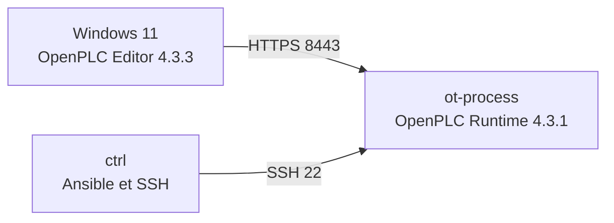

# Phase 05 — Déploiement et validation distante d'OpenPLC Runtime

## 1. Objectif

Cette phase fait passer le programme `Station_Pompage_OT`, validé localement pendant la phase 04, vers une exécution sur la machine virtuelle industrielle `ot-process`. Elle documente également la restauration des accès d'administration, les vérifications, le débogage distant et les résultats obtenus.

Le projet s'inscrit dans le laboratoire **IaC-OT — Infrastructure industrielle automatisée et sécurisée**. OpenPLC représente ici le contrôleur du procédé ; les futures phases apporteront Python, Modbus TCP, la supervision et les contrôles de cybersécurité.

## 2. Architecture utilisée

| Composant | Adresse / emplacement | Rôle |
|---|---|---|
| Hôte Windows 11 | `D:\Labo-IaC-OT\projet` | OpenPLC Editor 4.3.3, Git, Vagrant, VMware Workstation |
| `ctrl` | `192.168.75.134` (NAT), `192.168.56.10` (administration) | VM Ubuntu 24.04, Ansible, client SSH |
| `ot-process` | `192.168.75.135` (NAT), `192.168.100.10` (procédé) | VM Ubuntu 24.04, OpenPLC Runtime v4.3.1 |
| API OpenPLC | `https://192.168.75.135:8443` | Connexion sécurisée Editor ↔ Runtime |



**Important :** Runtime v4 est un service *headless*. L'adresse racine `/` répond en HTTP `404 Not Found` parce qu'il n'y a plus l'interface Web classique de Runtime v3. Le pilotage se fait depuis OpenPLC Editor et par son API. Le port `8443` répondait déjà correctement ; ce `404` n'était pas une panne.

## 3. Préparation et incidents rencontrés

### 3.1 Réparation du partage VMware sur `ctrl`

Après reprise du laboratoire, la commande `cd /vagrant/ansible` retournait `Transport endpoint is not connected`. Le montage VMware HGFS/FUSE apparaissait encore dans `mount`, mais le partage n'était plus accessible.

Depuis PowerShell, dans le répertoire du projet, un redémarrage contrôlé de `ctrl` a rétabli le montage :

```powershell
cd D:\Labo-IaC-OT\projet
vagrant reload default
vagrant ssh default -c "hostname && ls -la /vagrant/ansible"
```

Résultat vérifié : le nom d'hôte affiché était `ctrl`, et `inventory.ini` ainsi que `playbooks/` étaient accessibles. **`default` est l'identifiant Vagrant de la VM `ctrl`.** La réinstallation d'Ansible ou d'Ubuntu était inutile.

### 3.2 Réactivation de l'authentification SSH d'Ansible

L'appel Ansible initial échouait avec `Permission denied (publickey,password)` malgré une clé présente. Le diagnostic SSH détaillé montrait `Server accepts key` : la clé était reconnue par `ot-process`, mais sa passphrase empêchait l'authentification non interactive tant qu'elle n'était pas déverrouillée.

Depuis une session SSH sur `ctrl` :

```bash
eval "$(ssh-agent -s)"
ssh-add ~/.ssh/id_ed25519_ansible
cd /vagrant/ansible
ansible process -i inventory.ini -m ping
```

Résultat confirmé : `ot-process | SUCCESS`, `"ping": "pong"`. La passphrase n'est jamais stockée dans le dépôt. La clé privée reste sur `ctrl`, dans `/home/vagrant/.ssh/id_ed25519_ansible`.

### 3.3 Vérification du service

Depuis `ctrl`, dans `/vagrant/ansible` :

```bash
ansible process -i inventory.ini -b -m command -a "systemctl status openplc-runtime --no-pager"
```

Résultat observé : service `openplc-runtime.service` **active (running)** ; processus `webserver.app`, `etherdog` et `plc_main` présents. Les journaux indiquaient un serveur HTTPS sur `192.168.75.135:8443` et les requêtes `GET /` en `404`.

## 4. Programme industriel déployé

Le projet OpenPLC Editor est nommé `Station_Pompage_OT` et ses sources sont directement enregistrées dans `openplc/` dans le dépôt. Il contient trois réseaux Ladder :

1. Comparateur `LE` : `Niveau_Cuve <= Seuil_Bas` → `Demande_Demarrage`.
2. Comparateur `GE` : `Niveau_Cuve >= Seuil_Haut` → `Demande_Arret`.
3. Auto-maintien de `Pompe_Marche` : contact de démarrage en parallèle avec le contact de maintien, puis contact d'arrêt normalement fermé en série.

```text
Pompe_Marche := (Demande_Demarrage OR Pompe_Marche) AND NOT Demande_Arret
```

| Variable | Type | Valeur initiale connue | Rôle |
|---|---|---|---|
| `Niveau_Cuve` | REAL | `50.0` | Niveau du réservoir en % |
| `Seuil_Bas` | REAL | `30.0` | Seuil de démarrage |
| `Seuil_Haut` | REAL | `80.0` | Seuil d'arrêt |
| `Demande_Demarrage` | BOOL | `FALSE` | Résultat du seuil bas |
| `Demande_Arret` | BOOL | `FALSE` | Résultat du seuil haut |
| `Pompe_Marche` | BOOL | `FALSE` | Commande de la pompe |

La pompe est une **pompe de remplissage simulée**. Les seuils sont pédagogiques, pas une logique de sûreté industrielle certifiée.

## 5. Déploiement depuis OpenPLC Editor

1. Ouvrir `Station_Pompage_OT` dans OpenPLC Editor **4.3.3** sur Windows.
2. Sous **Device → Configuration**, choisir **OpenPLC Runtime v4** à la place de **OpenPLC Simulator**.
3. Saisir `192.168.75.135` comme adresse cible, puis cliquer sur **Connect**.
4. Lors de la première connexion seulement, créer le premier utilisateur Runtime avec un mot de passe fort et unique, non versionné ; l'utilisateur `admin` a été retenu.
5. Confirmer que **Disconnect** apparaît et que le PLC indique initialement **EMPTY**.
6. Enregistrer le projet avec **File → Save Project**.
7. Réaliser un snapshot VMware **avant** le déploiement : `PHASE-05-AVANT-DEPLOIEMENT-LADDER` (confirmé).
8. Dans la barre latérale gauche, ouvrir **Build Options** (flèche vers le bas) et choisir **Build and upload**.
9. Consulter **Console** et attendre la fin de la compilation et du transfert.

### Résultat réellement observé

La console a affiché les messages suivants :

```text
Compilation completed successfully (exit code: 0).
PLC started.
Upload complete.
Compilation complete
```

L'interface de configuration indiquait ensuite **PLC: RUNNING**. Il ne s'agit donc plus uniquement d'une simulation locale : le programme a été compilé, transféré et lancé sur `ot-process`.

Le résumé des plugins lors de ce déploiement signalait `0/5 enabled` (3 plugins Python, 2 plugins natifs), notamment `modbus_master: enabled=False`. **Ce résultat ne prouve pas que Modbus TCP serveur fonctionne : les échanges et les registres restent à tester en phase 06.**

## 6. Débogage distant et validation fonctionnelle

Dans OpenPLC Editor, l'outil **Debugger** (icône d'insecte) a ouvert une zone de surveillance des variables. Le programme Ladder réagissait aux changements de `Niveau_Cuve`, avec mise à jour du troisième réseau. L'utilisateur a confirmé que la séquence d'essais complète fonctionnait comme prévu.

| Étape | Niveau forcé pour le test | État attendu de `Pompe_Marche` | Validation |
|---|---:|---|---|
| 1 | 25 % | `TRUE` — démarrage | Confirmée par l'utilisateur |
| 2 | 50 % | `TRUE` — maintien | Confirmée par l'utilisateur |
| 3 | 80 % | `FALSE` — arrêt | Confirmée par l'utilisateur |
| 4 | 90 % | `FALSE` — maintien à l'arrêt | Confirmée par l'utilisateur |
| 5 | 50 % | `FALSE` — maintien à l'arrêt | Confirmée par l'utilisateur |
| 6 | 25 % | `TRUE` — redémarrage | Confirmée par l'utilisateur |

Ces résultats montrent l'effet d'hystérésis : dans la bande 30–80 %, l'état précédent de la pompe est conservé. Les essais ont été effectués dans un laboratoire virtuel et ne pilotaient aucun équipement physique.

## 7. Bilan de la phase 05

| Contrôle | État |
|---|---|
| Partage Vagrant/VMware sur `ctrl` | Rétabli |
| Accès SSH/Ansible à `ot-process` | Validé |
| Service OpenPLC Runtime v4.3.1 | Actif |
| Authentification OpenPLC Editor | Configurée |
| Compilation et transfert de `Station_Pompage_OT` | Réussis |
| Exécution distante | `RUNNING` |
| Débogage et essais d'hystérésis | Confirmés |
| Snapshot avant déploiement | Réalisé |
| Snapshot après validation `PHASE-05-OPENPLC-LADDER-VALIDE` | **À confirmer dans VMware** |
| Documentation Markdown et publication GitHub | En cours |

### Limitations connues

- Le test n'utilise pas encore de dynamique réelle de réservoir : la variable `Niveau_Cuve` a été modifiée manuellement dans le débogueur.
- Le port Modbus TCP `502`, les adresses des registres et les droits de lecture/écriture ne sont pas encore validés.
- Aucune VM de supervision, collecte InfluxDB ou visualisation Grafana n'a encore été installée.
- Le dépôt doit rester exempt de mots de passe, de clés privées et de fichiers temporaires de compilation.

## 8. Publication GitHub

Après avoir placé ce fichier dans `docs/phase-05-deploiement-openplc.md`, effectuer les vérifications suivantes dans PowerShell Windows :

```powershell
cd D:\Labo-IaC-OT\projet
git status -sb
git diff -- docs/phase-05-deploiement-openplc.md
git add docs/phase-05-deploiement-openplc.md
git commit -m "Phase 05 - Deploiement et validation distante OpenPLC"
git push origin main
```

Avant le commit, vérifier les éventuelles modifications de `openplc/project.json` provoquées par le changement de cible de simulation vers Runtime v4 et décider explicitement de leur inclusion. Ne pas ajouter `openplc/build/`, les secrets ou les captures contenant des identifiants.

## 9. Prochaine phase — Simulation physique Python et Modbus TCP

La phase 06 devra simuler automatiquement l'évolution du niveau de la cuve (débit de remplissage, consommation, limites 0–100 %, pas de temps). OpenPLC conservera la logique de commande Ladder ; Python simulera la partie physique. Les échanges Modbus TCP seront ajoutés après validation des registres et de la connectivité. Les données seront ensuite exploitables pour la supervision future avec InfluxDB et Grafana via Docker Compose.

---

**Références techniques :** [OpenPLC Runtime v4 — dépôt officiel](https://github.com/Autonomy-Logic/openplc-runtime) et [intégration avec OpenPLC Editor](https://github.com/Autonomy-Logic/openplc-runtime/blob/main/docs/EDITOR_INTEGRATION.md).
